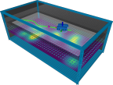
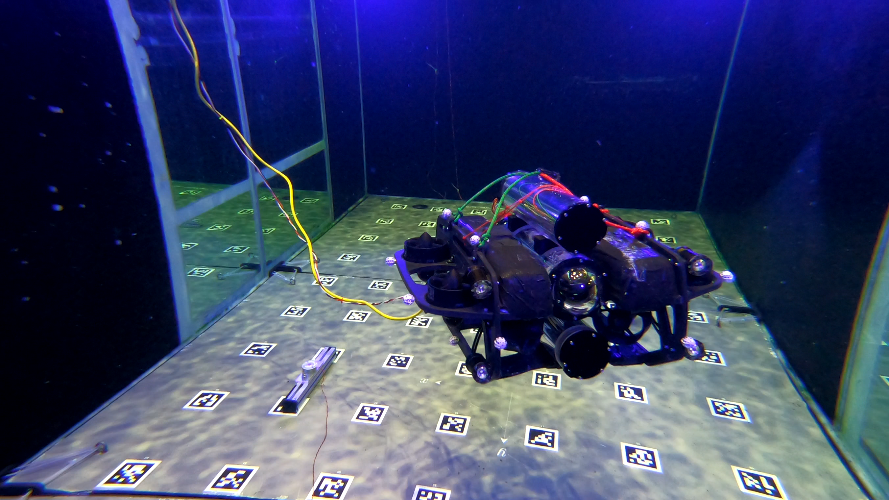

# IPP (Informative Path Planning)



`ipp` is a ROS 2 package for informative path planning with a BlueROV2 exploring an IR field in the institute's water tank (2 m by 4 m, set in `config/mapping_params.yaml`).

The planner reads a Gaussian Process belief of the field and replans adaptively in a receding-horizon loop using a RIG-tree (Hollinger & Sukhatme, IJRR 2014).

The package contains:

- RIG-tree planner, plus a lawnmower and a random baseline
- pure-pursuit path follower, position controller and yaw controller
- occupancy grid and obstacle scenarios for the tank
- bridges for the real IR sensor and motion capture

It is designed to work together with `scalar_field_sim` (simulated field and measurements) and `scalar_field_belief` (GP belief).

## Installation

The package is built in a ROS 2 Jazzy workspace. The examples below assume `~/ros2` as the workspace and `~/ros2/venv` as the Python virtual environment.

### 1. Clone the dependencies

Clone these packages into the same workspace as `ipp`.

```bash
cd ~/ros2/src
git clone https://github.com/HippoCampusRobotics/ipp_interfaces.git
git clone https://github.com/HippoCampusRobotics/scalar_field_interfaces.git
git clone https://github.com/HippoCampusRobotics/scalar_field_sim.git
git clone https://github.com/HippoCampusRobotics/scalar_field_belief.git
git clone https://github.com/HippoCampusRobotics/ipp_rviz_visuals.git
git clone https://github.com/teamspatzenhirn/rviz_2d_overlay_plugins.git
```

### 2. Create the Python virtual environment

`scalar_field_belief` needs `torch` and `gpytorch`, which are installed in a workspace-local virtual environment. `--system-site-packages` keeps the ROS Python packages from apt available inside it.

```bash
cd ~/ros2
python3 -m venv --system-site-packages venv
source ~/ros2/venv/bin/activate
python -m pip install --upgrade pip
python -m pip install torch gpytorch matplotlib
```

### 3. Install ROS dependencies

```bash
cd ~/ros2
rosdep install --from-paths src --ignore-src -r -y
```

### 4. Build the workspace

The virtual environment does not need to be active for the build.

```bash
cd ~/ros2
colcon build
```

## Run

Both launch files also start `scalar_field_belief`, so activate the virtual environment and source the workspace first.

```bash
cd ~/ros2
source ~/ros2/venv/bin/activate
source install/setup.bash
```

### Simulation

Gazebo runs headless, RViz starts automatically.

```bash
ros2 launch ipp simulation.launch.py
```

The simulated field is a `.toml` file from `scalar_field_sim/scenarios/`, set with the `scenario_path` launch argument (default `project-specific/ba-latosinszky/clustered_field_2.toml`). It needs the full path. Not to be confused with `scenario`, which only sets the obstacles. (combining them is future work)

```bash
ros2 launch ipp simulation.launch.py scenario_path:=$(ros2 pkg prefix --share scalar_field_sim)/scenarios/project-specific/ba-latosinszky/shared_fields/field_01.toml
```

### Real hardware

No Gazebo, uses the real IR sensor and motion capture.

```bash
ros2 launch ipp experiment.launch.py
```



### Planner services

Call these in a second terminal. `move_to_start` drives to the start pose and is optional, `start` also works from wherever the robot is.

> [!NOTE]
> On hardware, use `bluerov01` instead of `bluerov00`.

```bash
ros2 service call /bluerov00/path_planner/move_to_start std_srvs/srv/Trigger {}
ros2 service call /bluerov00/path_planner/start std_srvs/srv/Trigger {}
ros2 service call /bluerov00/path_planner/stop std_srvs/srv/Trigger {}
```

## Launch arguments

Both launch files take the same arguments, only some defaults differ.

| Argument | Sim | Hardware | Description |
|---|---|---|---|
| `vehicle_name` | `bluerov00` | `bluerov01` | Namespace of all topics and services |
| `planner` | `rig` | `rig` | `rig` (RIG-tree), `lawnmower` (coverage baseline), or `random` (RIG-tree without variance information) |
| `scenario` | empty | empty | Obstacle layout from `config/`, e.g. `scenario_1`. Empty means a free tank |
| `scenario_path` | `clustered_field_2` (no walls) | - | `scalar_field_sim` scenario of the simulated field, absolute or relative to the installed `scalar_field_sim` share directory |
| `wall_aware` | `false` | - | Use the wall-aware GP belief (`scalar_field_belief` `config/belief_params_wall_aware.yaml`) instead of `belief_params_default.yaml`; the belief then takes its walls from `scenario_path`, so the scenario must contain walls |
| `start_gui` | `false` | - | Show the Gazebo window |
| `rng_seed` | `-1` | `-1` | Seed for RIG-tree sampling, `-1` means unseeded |
| `planning_horizon` | `6` | `6` | Maximum number of tree nodes per planning cycle |
| `planning_time_s` | `2.0` | `2.0` | Planning time (s) per cycle |
| `roi_adaptive_enabled` | `false` | `false` | Region-of-interest weighting (Hitz et al. 2017) |
| `roi_threshold`, `roi_beta` | `0.008`, `2.0` | `0.008`, `2.0` | Parameters of the region-of-interest weighting |
| `goal_tolerance` | `0.15` | `0.3` | Distance (m) to the last waypoint that triggers replanning |
| `robot_z` | `-0.5` | `-0.84` | Depth (m) of all waypoints |
| `start_x`, `start_y` | `0.35` | `0.5` | Start pose (m) for `move_to_start` |
| `kp_xy`, `kp_z` | `1.0`, `2.0` | `20.0`, `3.0` | Position controller gains |
| `p_gain` | `0.1` | `0.2` | Yaw controller gain |

For instance, the lawnmower.

```bash
ros2 launch ipp simulation.launch.py planner:=lawnmower
```

With `wall_aware:=true`, the belief uses the walls of `scenario_path`. The
default scenario has no walls, so the belief node does not start with it; give a
scenario with walls instead, e.g.

```bash
ros2 launch ipp simulation.launch.py wall_aware:=true \
  scenario_path:=scenarios/tests/fields/01_single_wall.toml
```

## Region of interest (optional)

The region-of-interest weighting is a leftover and not part of the thesis. It still works and follows Hitz et al. (2017, Eq. 14 and 15). With `roi_adaptive_enabled:=true`, the information gain only counts grid points where `mean + roi_beta * sigma >= roi_threshold`, so the planner focuses on high field values. It is off by default.

```bash
ros2 launch ipp simulation.launch.py roi_adaptive_enabled:=true
```

## Measurements

`path_planner.py` calls the `trigger_ir_measurement` service whenever it needs a new measurement. The node that answers publishes a `ScalarMeasurement` on `ir_measurement`, and `scalar_field_belief` updates its GP from it.

- **Simulation.** `ir_measurement_sim_node.py` (package `scalar_field_sim`) samples the simulated field at the robot position.
- **Real hardware.** `ir_measurement_bridge.py` averages the last 0.1 s of the 9 photodiode topics `/photodiode_array/diode_1` to `diode_9` (50 Hz, published by `ads1115_publisher`) into one value. It shifts the position by the `ir_sensor` offset from `transformations_bluerov_default.yaml` (package `hippo_common`), so the GP gets the real sensor position. The controllers ignore this offset.

On real hardware, `qualisys_bridge` also publishes on `vision_pose_cov`, with a different message type. `experiment.launch.py` therefore remaps all IPP nodes to `vision_pose_cov_bridged`, which `vision_pose_bridge.py` fills from `ground_truth/odometry`.

## Obstacle Scenarios

Obstacle layouts are lists of polygons in `config/scenario_*.yaml`, with corners in metres. `scalar_field_sim` does not read these files. For now, an obstacle that should also block the simulated field has to be added to the `scalar_field_sim` scenario as well.

## Package structure

```text
nodes/
  path_planner.py            planner node (rig, lawnmower, or random)
  rig_tree.py                RIG-tree algorithm (Hollinger & Sukhatme 2014, Alg. 2)
  lawnmower.py               static lawnmower coverage path (baseline)
  path_follower.py           pure-pursuit waypoint follower
  position_controller.py     PD control in x/y, PID control in z
  yaw_controller.py          P control for yaw
  mapper.py                  occupancy grid from tank walls and obstacles
  obstacle_publisher.py      publishes the obstacles of a scenario
  vision_pose_bridge.py      hardware only, converts ground_truth/odometry for the IPP nodes
  ir_measurement_bridge.py   hardware only, see "Measurements"
launch/
  simulation.launch.py       Gazebo, field simulation, GP belief, and all IPP nodes
  experiment.launch.py       real hardware, IPP nodes plus bridges and GP belief
  ipp.launch.py              IPP nodes only, included by both
config/
  mapping_params.yaml        tank size and grid resolution
  scenario_*.yaml            obstacle layouts
  rviz.rviz                  RViz config for simulation
  rviz_experiment.rviz       RViz config for real hardware
  ir_sensor_offset_zero.yaml zero ir_sensor offset for simulation
```
